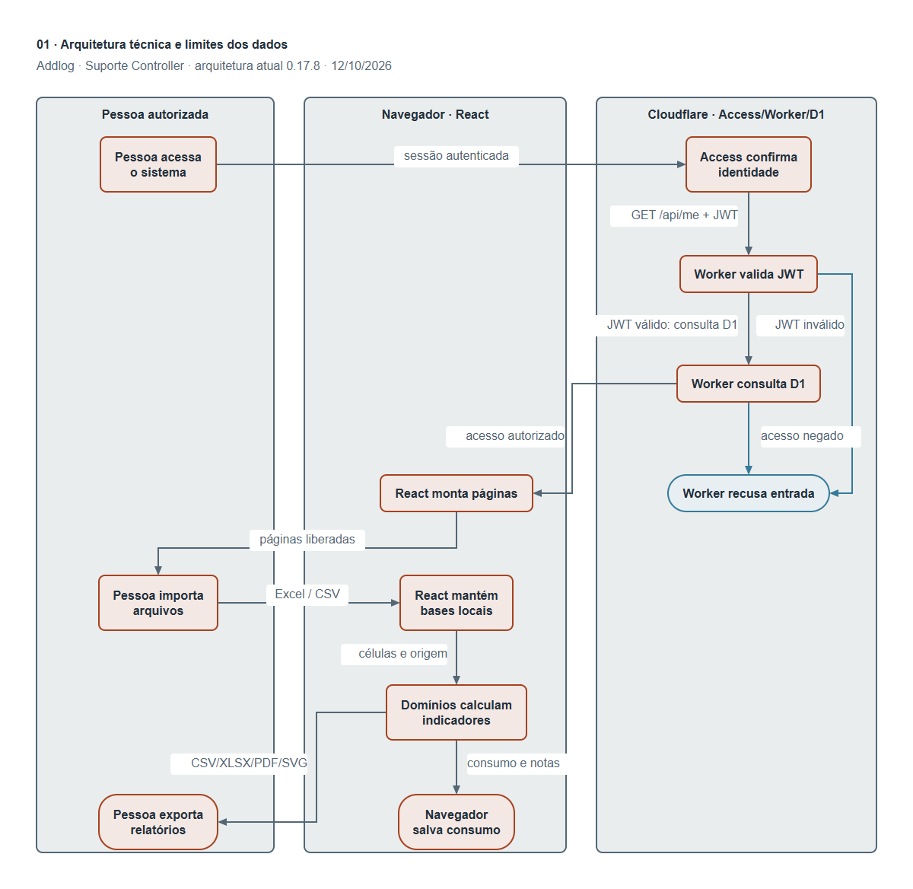
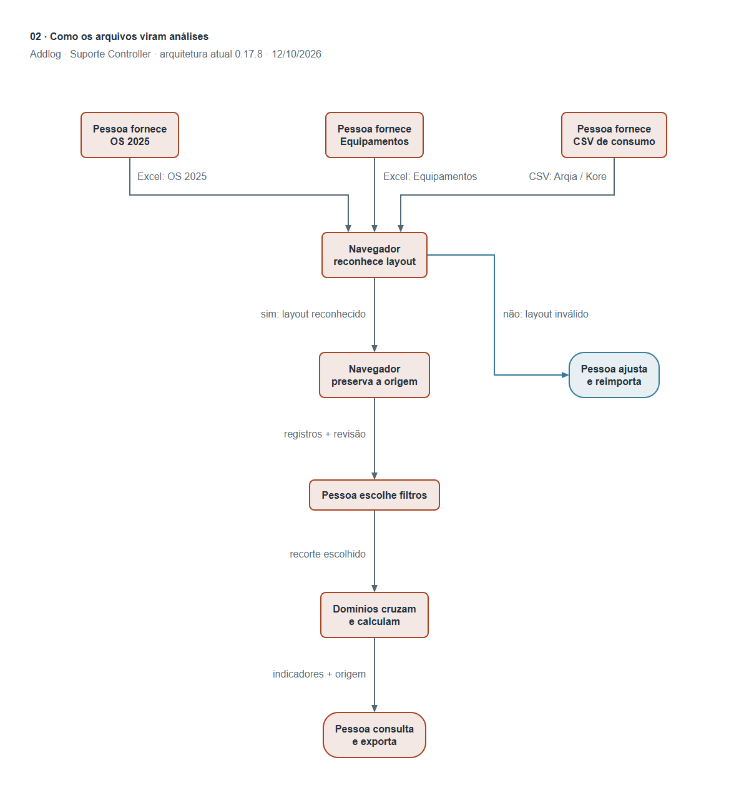

# Diagramas do sistema e guia de leitura

Referência: versão 0.17.8, conferida no código em 12/10/2026. Este guia explica os caminhos dos dados para usuários e para manutenção técnica. Os exemplos são conceituais e não contêm registros de clientes. Consulte os guias de cada módulo para as regras completas de cada relatório.

Complemento da versão 0.18.0: Logística também é lida localmente e mantida na memória do Workspace, com as abas Envios e Devoluções. O fluxo ilustrado continua representando reconhecimento, origem, filtros, revisão e exportação; os detalhes desse novo layout estão em [Logística de equipamentos](LOGISTICA-DE-EQUIPAMENTOS.md). Não existe nova rota de envio de planilhas ao servidor.

## 1. Arquitetura técnica

[Abrir SVG vetorial](diagrams/addlog-arquitetura-tecnica-swimlane.svg) · [Abrir PNG](diagrams/addlog-arquitetura-tecnica-swimlane.png)

As três áreas distinguem pessoa, navegador e Cloudflare. As setas indicam o que passa entre as etapas; os caminhos de recusa mostram as duas verificações necessárias antes de liberar o aplicativo.

### Etapas e conexões

1. **Pessoa acessa o sistema → Access confirma identidade:** a entrada passa pela autenticação configurada no Cloudflare Access.
2. **Access confirma identidade → Worker valida JWT:** o navegador consulta `GET /api/me`; o Worker verifica o token assinado encaminhado pelo Access.
3. **Worker valida JWT → Worker recusa entrada:** assinatura, emissor, audiência ou validade incompatíveis impedem o acesso à API.
4. **Worker valida JWT → Worker consulta D1:** com identidade válida, consulta o cadastro de usuário e suas permissões.
5. **Worker consulta D1 → Worker recusa entrada:** usuário não cadastrado, inativo ou sem autorização recebe recusa.
6. **Worker consulta D1 → React monta páginas:** a resposta permite montar as páginas autorizadas; páginas negadas não são montadas.
7. **React monta páginas → Pessoa importa arquivos:** a pessoa escolhe arquivos locais nas páginas ou na importação conjunta.
8. **Pessoa importa arquivos → React mantém bases locais:** os importadores leem Excel/CSV no navegador, sem enviar as planilhas ao Worker.
9. **React mantém bases locais → Domínios calculam indicadores:** valores, referências de origem e filtros alimentam as funções de análise de cada módulo.
10. **Domínios calculam indicadores → Navegador salva consumo:** o histórico de apurações e as observações de consumo podem ser gravados no IndexedDB local.
11. **Domínios calculam indicadores → Pessoa exporta relatórios:** os formatos disponíveis incluem CSV, XLSX, SVG e impressão para salvar PDF, conforme o relatório.

### Componentes e fronteiras

| Componente                  | Responsabilidade                                                   | Dados utilizados                              |
| --------------------------- | ------------------------------------------------------------------ | --------------------------------------------- |
| Cloudflare Access           | Autenticação na entrada, incluindo produção e prévias protegidas   | Identidade e sessão de autenticação           |
| Worker (`server/worker.js`) | Verifica JWT com `jose`, consulta permissões e administra usuários | Identidade validada, cadastro e permissões    |
| D1                          | Armazena somente usuários e permissões do sistema                  | Cadastro, perfil, páginas e ações autorizadas |
| AccessProvider              | Obtém a sessão antes de montar o Workspace                         | Resposta de `/api/me`                         |
| Workspace                   | Coordena navegação, importações e bases de OS/Operacional          | Bases na memória da sessão                    |
| Página de consumo           | Lê extratos e coordena histórico local                             | CSVs, apurações, vínculos e observações       |
| Funções `domain/`           | Aplicam as regras documentadas, sem modificar o arquivo            | Linhas originais, filtros e configurações     |
| Componentes React           | Apresentam cards, gráficos, revisão e relatórios                   | Resultados e referências de origem            |

A hospedagem entrega os arquivos estáticos produzidos pelo Vite e a API do Worker. A API possui `GET /api/me` e `GET/PUT /api/admin/users`; as operações de administração exigem perfil administrador. O token é verificado criptograficamente; o e-mail isolado não substitui essa verificação. Importar e exportar são ações separadas das permissões de página e reconsultam a sessão em produção antes da execução. Essa reconsulta não aparece como seta adicional no diagrama para manter a leitura clara.

No desenvolvimento local existe um modo de administrador local para testes. Em produção, falha na consulta de identidade não libera as páginas automaticamente. O módulo de Monitoramento ainda usa demonstração fictícia: não há coleta real da API de rastreamento nem transmissão ao vivo nesta etapa.

### Onde os dados permanecem

| Informação                                                                                                         | Local                            | Persistência                                                                       |
| ------------------------------------------------------------------------------------------------------------------ | -------------------------------- | ---------------------------------------------------------------------------------- |
| OS e operacional importados para análise                                                                           | Memória do navegador             | Recarregar a página exige nova importação                                          |
| Histórico de consumo salvo, observações, arquivos CSV e referência operacional eventualmente salva com o histórico | IndexedDB do navegador           | Permanece até exclusão ou limpeza do armazenamento; pode receber backup JSON local |
| Preferências de tema, apresentação e configurações de relatórios                                                   | Armazenamento local do navegador | Permanece nesse perfil e endereço do site                                          |
| Usuários e permissões                                                                                              | D1 no Cloudflare                 | Compartilhado pelo sistema de controle de acesso                                   |
| Relatórios exportados                                                                                              | Arquivo baixado ou impressão     | Ficam no destino escolhido pela pessoa                                             |

O armazenamento local pertence ao **perfil do navegador e à origem do site**, não a uma conta individual do aplicativo. Duas pessoas usando o mesmo perfil e endereço podem acessar dados locais já salvos. Não há sincronização automática de planilhas ou histórico entre computadores. Nenhuma rota atual envia as planilhas, as apurações ou as observações ao D1. Os arquivos baixados devem ser administrados pela empresa como qualquer outro relatório.

## 2. Fluxo instrucional da leitura

[Abrir SVG vetorial](diagrams/addlog-leitura-instrucional-flowchart.svg) · [Abrir PNG](diagrams/addlog-leitura-instrucional-flowchart.png)

### Etapas e conexões

1. **Pessoa fornece OS 2025 → Navegador reconhece layout:** arquivo Excel com a aba de serviços.
2. **Pessoa fornece Equipamentos → Navegador reconhece layout:** arquivo Excel com o cadastro operacional.
3. **Pessoa fornece CSV de consumo → Navegador reconhece layout:** extrato Arqia ou Kore, identificado pelos cabeçalhos.
4. **Navegador reconhece layout → Pessoa ajusta e reimporta:** estrutura incompatível impede a leitura; a importação anterior permanece disponível.
5. **Navegador reconhece layout → Navegador preserva a origem:** estrutura reconhecida permite montar registros, valores originais e referências de linha/coluna.
6. **Navegador preserva a origem → Pessoa escolhe filtros:** a pessoa recebe registros e avisos de revisão e define o recorte.
7. **Pessoa escolhe filtros → Domínios cruzam e calculam:** somente registros elegíveis de cada indicador entram em sua base; vínculos usam o contexto original quando necessário.
8. **Domínios cruzam e calculam → Pessoa consulta e exporta:** cards, gráficos e tabelas mostram resultados, critérios e linhas para conferência.

Erro de **estrutura** pode impedir a importação inteira. Problema de **conteúdo de uma célula** pode permitir a importação, mas exigir revisão ou exclusão apenas do cálculo afetado. Uma célula vazia não se transforma automaticamente em zero. Ajustes são feitos na planilha original, seguida de nova importação.

## 3. O que cada importador lê

### Ordens de Serviço

- Abas aceitas: **`OS 2025_26`** (atual) ou **`OS 2025`** (anterior), mesmo que o arquivo tenha somente uma aba. O nome OS 2025 nos diagramas também exemplifica o fluxo do formato atual. Arquivo com as duas abas reconhecidas exige definir uma única base antes de importar.
- Cabeçalhos na **primeira linha**. A coluna **A** identifica o número da OS; linhas seguintes sem esse número ficam fora da importação e são contabilizadas quando contêm outros dados.
- Lê todas as colunas com cabeçalho não vazio, preservando a ordem física. Abas de base de clientes e técnicos não são usadas por esse importador.
- Cada linha é um serviço/atendimento. O mesmo número de OS pode aparecer em várias linhas e representa um chamado com vários serviços.
- Mantém valor original, conteúdo exibido, referência de linha Excel, cabeçalho, letra e índice da coluna. Erros do Excel e formatos incompatíveis geram avisos. O navegador não recalcula fórmulas: usa os resultados gravados no arquivo.

| Campos usados na análise                  | Para que servem                                                                              |
| ----------------------------------------- | -------------------------------------------------------------------------------------------- |
| Número da OS e `Status`                   | Chamados distintos, serviços por chamado e separação entre realizados/cancelados/outros      |
| `Razão Social`, `Cidade`, `UF`            | Recortes de cliente e região                                                                 |
| `Cód.`, `Nome do Técnico`                 | Código que identifica o técnico e nome para apresentação                                     |
| `Resp. Execução`, `Resp. Agendamento`     | Filtros separados de responsáveis do suporte, com vários nomes por papel                     |
| `Data de atendimento`, `Agendamento`      | Período dos atendimentos e análises específicas de agenda                                    |
| `Tipo de Serviço`, `Motivo`, `Instruções` | Perfil de intervenções, visitas improdutivas e identificação padronizada de acessórios       |
| `Placa`, `ID Rastreador`                  | Histórico, vínculos e ciclos de equipamentos conforme os cabeçalhos reconhecidos pelo módulo |
| `Cobrança`, `Valor a cobrar`              | Valor contratual atribuído ao cliente ou absorvido pela Addlog                               |
| `Técnico`, `Km`, `Custo Total`            | Serviço técnico, deslocamento em reais e custo total lançado                                 |

Os nomes precisam corresponder aos cabeçalhos usados pelo código: renomear uma coluna pode deixar seu indicador indisponível. Esta tabela explica os grupos de informação; não autoriza renomear os cabeçalhos do arquivo.

### Operacional

- Aba exigida: **`Equipamentos`**.
- Layout atual: **A:BY, 77 colunas**. O sistema confere `A1 = Nº`, `BH1 = Equipamentos`, `BF1 = Placa instalada` e `AU1 = Situação`.
- Lê linhas a partir da segunda, com identificador em A. Preserva valores, conteúdo exibido, fórmula quando disponível, erro e linha de origem.
- Este importador usa **posições fixas**. Mover colunas exige revisar o mapeamento, mesmo que o texto do cabeçalho continue igual.

| Coluna  | Informação interpretada                                                               |
| ------- | ------------------------------------------------------------------------------------- |
| A       | Identificador do registro (`Nº`)                                                      |
| B / C   | Documento e cliente                                                                   |
| S / T   | Início e fim do ciclo; significado contratual ainda depende de confirmação financeira |
| AK      | Plano                                                                                 |
| AS / AT | Mensalidade e condição de cobrança                                                    |
| AU / AV | Situação e data de cancelamento                                                       |
| BC      | Data de implementação                                                                 |
| BF      | Placa instalada                                                                       |
| BH / BJ | Identificador e modelo do equipamento                                                 |
| BM / BN | Número da linha e ICCID                                                               |

As demais colunas ficam disponíveis como origem. Erros, ausências, identificadores com possível perda de precisão, duplicidades e vínculos ambíguos geram revisão conforme as regras do módulo. Uma referência operacional sem histórico correspondente de OS não é automaticamente erro: a operacional é mais antiga e as OS têm cobertura limitada.

### Consumo M2M

O sistema reconhece o provedor pelos cabeçalhos e mantém as colunas, células e linhas físicas do CSV. Identificadores são tratados como texto para preservar zeros iniciais e números longos. Na importação conjunta, a leitura tenta UTF-8 e usa Windows-1252 quando necessário.

| Layout | Identificação e principais campos                                                                                                             |
| ------ | --------------------------------------------------------------------------------------------------------------------------------------------- |
| Arqia  | Reconhecido por `Consumo (MB)` e `Período Início`; lê ICCID, MSISDN/MSISN, início/fim da apuração, volume, plano e dados cadastrais presentes |
| Kore   | Reconhecido por `Consumo total` e `Serviço`; lê início/fim, produto, serviço, empresa, status, identificadores e campos monetários presentes  |

Volumes KB/MB/GB são convertidos somente para análise, com fator 1024 entre unidades. SMS e frete são tratados separadamente de dados. Zero válido participa da base; consumo ausente/incompatível não vira zero. Grupos repetidos de identificador/período ficam fora dos totais para revisão antes dos recortes. Não se somam fotografias sobrepostas do mesmo período como se fossem consumos adicionais.

Tecnologia depende de um campo explícito disponível; não é deduzida automaticamente do plano. Plano não equivale a contrato. Relacionamento contratual mais amplo e consumo em tempo real ainda precisam de fonte e regras adicionais.

### Importação conjunta

Na página Importação é possível selecionar vários arquivos. Um Excel pode conter OS e Equipamentos. O lote aceita no máximo uma base de OS e uma operacional, além de vários CSVs; duplicidades e versões de extratos seguem as regras do histórico. A gravação local do consumo ocorre antes de substituir as referências de OS/Operacional. Se essa gravação falhar, as bases anteriores são preservadas.

## 4. Regras que mudam a interpretação dos números

| Regra                       | Efeito na leitura                                                                                                                   |
| --------------------------- | ----------------------------------------------------------------------------------------------------------------------------------- |
| `Concluída` ou `Pago`       | Serviço/visita registrado como realizado. `Pago` informa pagamento ao técnico; não comprova recebimento do cliente                  |
| `Cancelada`                 | Conta separadamente para registro e ignora todos os custos da linha                                                                 |
| Motivo `Visita Improdutiva` | Conta como visita realizada, mas não como manutenção efetiva; custos válidos permanecem nos indicadores financeiros                 |
| `Custo Total` lançado       | É o valor usado no total. Diferença de R$ 0,01 ou mais em relação a Técnico + Km gera conferência, sem correção automática          |
| `Km`                        | Valor monetário do deslocamento, não distância percorrida                                                                           |
| Cobrança Addlog             | Valor contratual absorvido pela empresa; não confundir esse valor com Custo Total técnico                                           |
| Datas ausentes/inválidas    | Ficam fora do recorte com limite de período e dos gráficos temporais; não são preenchidas automaticamente                           |
| Filtros múltiplos           | OU entre nomes de um campo, E entre campos. Execução e agendamento permanecem separados                                             |
| Reincidência                | Agrupa cliente + placa, reúne serviços do mesmo dia e mede nova visita em até 30/60/90 dias cumulativos; retorno não comprova falha |
| Duração até primeira troca  | Usa vínculos confirmados e ciclos com evento registrado; média, mínimo e máximo não incluem ciclos ainda sem troca como zero        |
| Base histórica limitada     | Ausência de evento não comprova ausência de problema; tempos observados não representam toda a vida útil de todos os equipamentos   |

## 5. Como os módulos se relacionam

- **OS → OS:** número de chamado reúne linhas; cliente/placa reúne intervenções; serial/placa e datas apoiam os ciclos. Identificar troca de rastreador exige as condições documentadas, não apenas repetir a placa.
- **OS ↔ Operacional:** identificador do rastreador e placa permitem vínculos conferidos. Correspondência ambígua ou contraditória exige revisão, sem escolher um cadastro automaticamente.
- **Consumo ↔ Operacional:** ICCID e número conferidos no mesmo registro permitem mostrar cliente, placa, equipamento e modelo. Cadastros duplicados, identificadores incompatíveis ou referências diferentes exigem conferência.
- **Consumo ↔ histórico local:** apurações, observações e marcações formam uma linha do tempo por chip. A referência atual do operacional não prova que o veículo era o mesmo em todos os períodos passados.
- **Monitoramento futuro:** API, tokens, limites de coleta e armazenamento de falhas ainda dependem de definição com o desenvolvimento. Não estão ativos no fluxo atual.

Esses cruzamentos ajudam a localizar divergências e selecionar registros para estudo. Não alteram os arquivos nem resolvem automaticamente identidade de cliente, contrato ou equipamento.

## 6. Roteiro de estudo e manutenção

| Assunto                  | Código / guia                                                                                                                                               |
| ------------------------ | ----------------------------------------------------------------------------------------------------------------------------------------------------------- |
| Coordenação e lote       | `src/app/Workspace.jsx`, `src/modules/imports/domain/bulkImport.js`; [Importação](IMPORTACAO.md)                                                            |
| Entrada, acesso e banco  | `src/shared/security/Access.jsx`, `server/worker.js`; [Usuários e permissões](USUARIOS-E-PERMISSOES.md)                                                     |
| OS e filtros             | `src/modules/orders/data/import.js`, `src/shared/data/filters.js`; [Filtros](FILTROS-E-APRESENTACAO.md)                                                     |
| Financeiro e indicadores | `src/modules/orders/domain/analysis.js`, `insights.js`; [Produto](PRODUTO.md), [Análises](ANALISES-DE-OS.md)                                                |
| Equipamentos e ciclos    | `src/modules/orders/domain/fieldLife.js`, `lifecycle.js`, `trackerReplacements.js`; [Vida em campo](VIDA-EM-CAMPO.md)                                       |
| Operacional e parque     | `src/modules/operational/domain/operational.js`, `src/modules/park/domain/parkAnalysis.js`; [Operacional](OPERACIONAL.md), [Parque](PARQUE-E-MANUTENCAO.md) |
| Consumo e persistência   | `src/modules/consumption/domain/lineConsumption.js`, `src/modules/consumption/data/historyRepository.js`; [Consumo](CONSUMO-DE-LINHAS.md)                   |
| Monitoramento preparado  | `src/modules/monitoring/`; [Monitoramento](MONITORAMENTO-DE-FROTA.md)                                                                                       |

Ao alterar um importador, um vínculo ou a persistência, confira este guia e os diagramas. Atualize os caminhos, as setas e os campos que mudaram; não inclua identificadores privados, tokens ou dados de clientes. Valide os testes do domínio e execute `npm run check` antes de publicar alterações do aplicativo.

Os SVGs são os arquivos vetoriais editáveis; os PNGs facilitam consulta e inserção em documentos. A arquitetura usa raias verticais e o fluxo instrucional segue de cima para baixo, com ramos explícitos de aceitação e recusa. Paleta: texto `#23303B`, fundo `#FFFFFF`, destaque `#A6421F`, apoio `#536775` e conexão `#357A9A`. Os rótulos curtos dos desenhos são explicados nas etapas numeradas deste guia.
