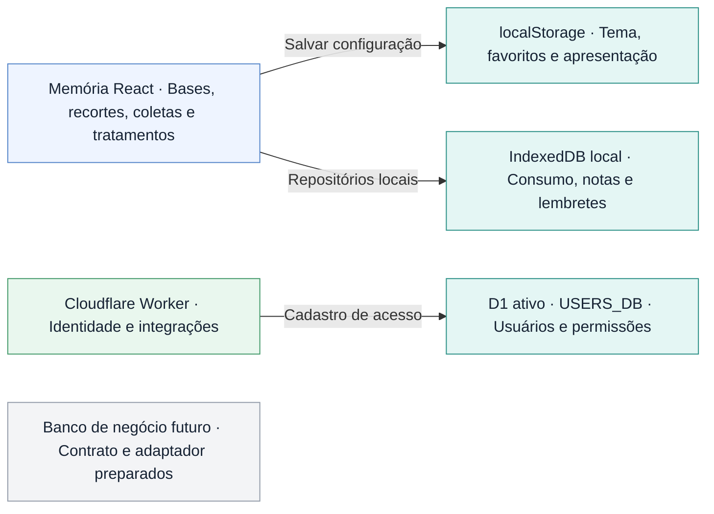

# Mapa técnico Addlog 0.55.0

Fluxos gerais preservados da referência anterior. Guia e catálogo descrevem a versão 0.55.0 (80db355 · cópia da entrega, 2026-10-22). Os detalhes recentes estão no guia e no catálogo; o acesso compartilhado é um site documental independente.

## Arquitetura geral

Três ambientes: navegador, Cloudflare e laboratório no computador.

```mermaid
flowchart LR
  accTitle: Arquitetura geral
  accDescr: Planilhas manuais são processadas no navegador. D1 ativo não armazena todas as bases de negócio.
  web["Navegador · React · interface e análises"]
  class web app
  worker["Cloudflare Worker · API autenticada · /api/*"]
  class worker cloud
  sources["Google Sheets + Zoho · Consultas privadas de leitura"]
  class sources cloud
  session["Workspace + módulos · Bases e filtros da sessão"]
  class session app
  users["D1 · USERS_DB · Usuários e permissões"]
  class users store
  collector["Coletor de veículos · Binding ainda não configurado"]
  class collector future
  browserdb["Armazenamento local · Preferências, consumo, lembretes"]
  class browserdb store
  bridge["Ponte local · 5681 · Acervo + ferramentas restritas"]
  class bridge local
  agent["n8n local + Gemini · Modelo explica resultados"]
  class agent local
  web -->|HTTP /api| worker
  worker -->|OAuth / leitura| sources
  web -->|Estado React| session
  session -->|Persistência seletiva| browserdb
  worker -->|Acesso| users
  worker -.->|Rota preparada| collector
  session -->|Assistente&#58; HTTP local| bridge
  bridge -->|CLI + ferramentas| agent
classDef app fill:#eef4ff,stroke:#5484c8,color:#172334
classDef domain fill:#fff1dc,stroke:#df8a25,color:#172334
classDef cloud fill:#e9f7ee,stroke:#42996a,color:#172334
classDef store fill:#e4f6f4,stroke:#2b9086,color:#172334
classDef local fill:#f2ebff,stroke:#9670cc,color:#172334
classDef future fill:#f3f4f6,stroke:#929ba9,color:#172334
%% portable-canonical-v2:eyJhY2Nlc3NpYmlsaXR5IjoiUGxhbmlsaGFzIG1hbnVhaXMgc8OjbyBwcm9jZXNzYWRhcyBubyBuYXZlZ2Fkb3IuIEQxIGF0aXZvIG7Do28gYXJtYXplbmEgdG9kYXMgYXMgYmFzZXMgZGUgbmVnw7NjaW8uIiwiZGF0YSI6eyJkaXJlY3Rpb24iOiJMUiIsImVkZ2VzIjpbeyJhcnJvdyI6Ii0tPiIsImZyb20iOiJ3ZWIiLCJsYWJlbCI6IkhUVFAgL2FwaSIsInRvIjoid29ya2VyIn0seyJhcnJvdyI6Ii0tPiIsImZyb20iOiJ3b3JrZXIiLCJsYWJlbCI6Ik9BdXRoIC8gbGVpdHVyYSIsInRvIjoic291cmNlcyJ9LHsiYXJyb3ciOiItLT4iLCJmcm9tIjoid2ViIiwibGFiZWwiOiJFc3RhZG8gUmVhY3QiLCJ0byI6InNlc3Npb24ifSx7ImFycm93IjoiLS0-IiwiZnJvbSI6InNlc3Npb24iLCJsYWJlbCI6IlBlcnNpc3TDqm5jaWEgc2VsZXRpdmEiLCJ0byI6ImJyb3dzZXJkYiJ9LHsiYXJyb3ciOiItLT4iLCJmcm9tIjoid29ya2VyIiwibGFiZWwiOiJBY2Vzc28iLCJ0byI6InVzZXJzIn0seyJhcnJvdyI6Ii0uLT4iLCJmcm9tIjoid29ya2VyIiwibGFiZWwiOiJSb3RhIHByZXBhcmFkYSIsInRvIjoiY29sbGVjdG9yIn0seyJhcnJvdyI6Ii0tPiIsImZyb20iOiJzZXNzaW9uIiwibGFiZWwiOiJBc3Npc3RlbnRlOiBIVFRQIGxvY2FsIiwidG8iOiJicmlkZ2UifSx7ImFycm93IjoiLS0-IiwiZnJvbSI6ImJyaWRnZSIsImxhYmVsIjoiQ0xJICsgZmVycmFtZW50YXMiLCJ0byI6ImFnZW50In1dLCJub2RlcyI6W3siY2xhc3MiOiJhcHAiLCJpZCI6IndlYiIsImxhYmVsIjoiTmF2ZWdhZG9yIMK3IFJlYWN0IMK3IGludGVyZmFjZSBlIGFuw6FsaXNlcyJ9LHsiY2xhc3MiOiJjbG91ZCIsImlkIjoid29ya2VyIiwibGFiZWwiOiJDbG91ZGZsYXJlIFdvcmtlciDCtyBBUEkgYXV0ZW50aWNhZGEgwrcgL2FwaS8qIn0seyJjbGFzcyI6ImNsb3VkIiwiaWQiOiJzb3VyY2VzIiwibGFiZWwiOiJHb29nbGUgU2hlZXRzICsgWm9obyDCtyBDb25zdWx0YXMgcHJpdmFkYXMgZGUgbGVpdHVyYSJ9LHsiY2xhc3MiOiJhcHAiLCJpZCI6InNlc3Npb24iLCJsYWJlbCI6IldvcmtzcGFjZSArIG3Ds2R1bG9zIMK3IEJhc2VzIGUgZmlsdHJvcyBkYSBzZXNzw6NvIn0seyJjbGFzcyI6InN0b3JlIiwiaWQiOiJ1c2VycyIsImxhYmVsIjoiRDEgwrcgVVNFUlNfREIgwrcgVXN1w6FyaW9zIGUgcGVybWlzc8O1ZXMifSx7ImNsYXNzIjoiZnV0dXJlIiwiaWQiOiJjb2xsZWN0b3IiLCJsYWJlbCI6IkNvbGV0b3IgZGUgdmXDrWN1bG9zIMK3IEJpbmRpbmcgYWluZGEgbsOjbyBjb25maWd1cmFkbyJ9LHsiY2xhc3MiOiJzdG9yZSIsImlkIjoiYnJvd3NlcmRiIiwibGFiZWwiOiJBcm1hemVuYW1lbnRvIGxvY2FsIMK3IFByZWZlcsOqbmNpYXMsIGNvbnN1bW8sIGxlbWJyZXRlcyJ9LHsiY2xhc3MiOiJsb2NhbCIsImlkIjoiYnJpZGdlIiwibGFiZWwiOiJQb250ZSBsb2NhbCDCtyA1NjgxIMK3IEFjZXJ2byArIGZlcnJhbWVudGFzIHJlc3RyaXRhcyJ9LHsiY2xhc3MiOiJsb2NhbCIsImlkIjoiYWdlbnQiLCJsYWJlbCI6Im44biBsb2NhbCArIEdlbWluaSDCtyBNb2RlbG8gZXhwbGljYSByZXN1bHRhZG9zIn1dfSwiZGVzY3JpcHRpb24iOiJUcsOqcyBhbWJpZW50ZXM6IG5hdmVnYWRvciwgQ2xvdWRmbGFyZSBlIGxhYm9yYXTDs3JpbyBubyBjb21wdXRhZG9yLiIsImlkIjoibWFwXzAxLWFycXVpdGV0dXJhIiwia2luZCI6ImZsb3djaGFydCIsInNvdXJjZVNoYTI1NiI6IjA0MzNkMzE3ZmZiNTBhNzJhYWM5NzU4NzRjMDAwZmI3ODBmOThmMjM4MTdjODk2MWNhMjA3MDVlNmRmZDU0NmYiLCJzdHlsZXMiOlt7ImRlZmluaXRpb24iOiJmaWxsOiNlZWY0ZmYsc3Ryb2tlOiM1NDg0YzgsY29sb3I6IzE3MjMzNCIsIm5hbWUiOiJhcHAifSx7ImRlZmluaXRpb24iOiJmaWxsOiNmZmYxZGMsc3Ryb2tlOiNkZjhhMjUsY29sb3I6IzE3MjMzNCIsIm5hbWUiOiJkb21haW4ifSx7ImRlZmluaXRpb24iOiJmaWxsOiNlOWY3ZWUsc3Ryb2tlOiM0Mjk5NmEsY29sb3I6IzE3MjMzNCIsIm5hbWUiOiJjbG91ZCJ9LHsiZGVmaW5pdGlvbiI6ImZpbGw6I2U0ZjZmNCxzdHJva2U6IzJiOTA4Nixjb2xvcjojMTcyMzM0IiwibmFtZSI6InN0b3JlIn0seyJkZWZpbml0aW9uIjoiZmlsbDojZjJlYmZmLHN0cm9rZTojOTY3MGNjLGNvbG9yOiMxNzIzMzQiLCJuYW1lIjoibG9jYWwifSx7ImRlZmluaXRpb24iOiJmaWxsOiNmM2Y0ZjYsc3Ryb2tlOiM5MjliYTksY29sb3I6IzE3MjMzNCIsIm5hbWUiOiJmdXR1cmUifV0sInRpdGxlIjoiQXJxdWl0ZXR1cmEgZ2VyYWwiLCJ2ZXJzaW9uIjoxfQ
```

<!-- mermaid:id=map_01-arquitetura -->

## Da fonte ao indicador

A entrada muda; o importador e as regras analíticas continuam compartilhados.

<!-- mermaid:id=map_02-leitura -->

## Como os módulos compartilham dados

Compartilhamento explícito pelo Workspace e pelos coordenadores de página.

```mermaid
flowchart LR
  accTitle: Como os módulos compartilham dados
  accDescr: O Monitoramento tem fonte independente. A referência Operacional só chega a OS quando há permissão de Parque.
  imports["Importação conjunta · Prévia e lote autorizado"]
  class imports app
  workspace["Workspace · Bases OS / Operacional / Logística"]
  class workspace app
  monitor["Monitoramento Ativo · Fonte e lembretes próprios"]
  class monitor app
  orders["Ordens de Serviço · Operação · custos · suporte · ciclos"]
  class orders app
  operational["OperationalPage · Cadastro e coordenador do Parque"]
  class operational app
  consumption["Consumo M2M · Extratos + referência operacional"]
  class consumption app
  zoho["ZohoSession · Uma coleta para resumo e equipe"]
  class zoho cloud
  park["Parque e Manutenção · Operacional × histórico de OS"]
  class park domain
  logistics["Logística no Parque · Envios e Devoluções"]
  class logistics app
  imports -->|Aplica lote| workspace
  workspace -->|OS| orders
  workspace -->|OS + Operacional| operational
  workspace -->|Referência + revisão| consumption
  zoho -->|Contexto compartilhado| orders
  operational -->|Vínculos e análises| park
  operational -->|Base logística| logistics
classDef app fill:#eef4ff,stroke:#5484c8,color:#172334
classDef domain fill:#fff1dc,stroke:#df8a25,color:#172334
classDef cloud fill:#e9f7ee,stroke:#42996a,color:#172334
classDef store fill:#e4f6f4,stroke:#2b9086,color:#172334
classDef local fill:#f2ebff,stroke:#9670cc,color:#172334
classDef future fill:#f3f4f6,stroke:#929ba9,color:#172334
%% portable-canonical-v2:eyJhY2Nlc3NpYmlsaXR5IjoiTyBNb25pdG9yYW1lbnRvIHRlbSBmb250ZSBpbmRlcGVuZGVudGUuIEEgcmVmZXLDqm5jaWEgT3BlcmFjaW9uYWwgc8OzIGNoZWdhIGEgT1MgcXVhbmRvIGjDoSBwZXJtaXNzw6NvIGRlIFBhcnF1ZS4iLCJkYXRhIjp7ImRpcmVjdGlvbiI6IkxSIiwiZWRnZXMiOlt7ImFycm93IjoiLS0-IiwiZnJvbSI6ImltcG9ydHMiLCJsYWJlbCI6IkFwbGljYSBsb3RlIiwidG8iOiJ3b3Jrc3BhY2UifSx7ImFycm93IjoiLS0-IiwiZnJvbSI6IndvcmtzcGFjZSIsImxhYmVsIjoiT1MiLCJ0byI6Im9yZGVycyJ9LHsiYXJyb3ciOiItLT4iLCJmcm9tIjoid29ya3NwYWNlIiwibGFiZWwiOiJPUyArIE9wZXJhY2lvbmFsIiwidG8iOiJvcGVyYXRpb25hbCJ9LHsiYXJyb3ciOiItLT4iLCJmcm9tIjoid29ya3NwYWNlIiwibGFiZWwiOiJSZWZlcsOqbmNpYSArIHJldmlzw6NvIiwidG8iOiJjb25zdW1wdGlvbiJ9LHsiYXJyb3ciOiItLT4iLCJmcm9tIjoiem9obyIsImxhYmVsIjoiQ29udGV4dG8gY29tcGFydGlsaGFkbyIsInRvIjoib3JkZXJzIn0seyJhcnJvdyI6Ii0tPiIsImZyb20iOiJvcGVyYXRpb25hbCIsImxhYmVsIjoiVsOtbmN1bG9zIGUgYW7DoWxpc2VzIiwidG8iOiJwYXJrIn0seyJhcnJvdyI6Ii0tPiIsImZyb20iOiJvcGVyYXRpb25hbCIsImxhYmVsIjoiQmFzZSBsb2fDrXN0aWNhIiwidG8iOiJsb2dpc3RpY3MifV0sIm5vZGVzIjpbeyJjbGFzcyI6ImFwcCIsImlkIjoiaW1wb3J0cyIsImxhYmVsIjoiSW1wb3J0YcOnw6NvIGNvbmp1bnRhIMK3IFByw6l2aWEgZSBsb3RlIGF1dG9yaXphZG8ifSx7ImNsYXNzIjoiYXBwIiwiaWQiOiJ3b3Jrc3BhY2UiLCJsYWJlbCI6IldvcmtzcGFjZSDCtyBCYXNlcyBPUyAvIE9wZXJhY2lvbmFsIC8gTG9nw61zdGljYSJ9LHsiY2xhc3MiOiJhcHAiLCJpZCI6Im1vbml0b3IiLCJsYWJlbCI6Ik1vbml0b3JhbWVudG8gQXRpdm8gwrcgRm9udGUgZSBsZW1icmV0ZXMgcHLDs3ByaW9zIn0seyJjbGFzcyI6ImFwcCIsImlkIjoib3JkZXJzIiwibGFiZWwiOiJPcmRlbnMgZGUgU2VydmnDp28gwrcgT3BlcmHDp8OjbyDCtyBjdXN0b3Mgwrcgc3Vwb3J0ZSDCtyBjaWNsb3MifSx7ImNsYXNzIjoiYXBwIiwiaWQiOiJvcGVyYXRpb25hbCIsImxhYmVsIjoiT3BlcmF0aW9uYWxQYWdlIMK3IENhZGFzdHJvIGUgY29vcmRlbmFkb3IgZG8gUGFycXVlIn0seyJjbGFzcyI6ImFwcCIsImlkIjoiY29uc3VtcHRpb24iLCJsYWJlbCI6IkNvbnN1bW8gTTJNIMK3IEV4dHJhdG9zICsgcmVmZXLDqm5jaWEgb3BlcmFjaW9uYWwifSx7ImNsYXNzIjoiY2xvdWQiLCJpZCI6InpvaG8iLCJsYWJlbCI6IlpvaG9TZXNzaW9uIMK3IFVtYSBjb2xldGEgcGFyYSByZXN1bW8gZSBlcXVpcGUifSx7ImNsYXNzIjoiZG9tYWluIiwiaWQiOiJwYXJrIiwibGFiZWwiOiJQYXJxdWUgZSBNYW51dGVuw6fDo28gwrcgT3BlcmFjaW9uYWwgw5cgaGlzdMOzcmljbyBkZSBPUyJ9LHsiY2xhc3MiOiJhcHAiLCJpZCI6ImxvZ2lzdGljcyIsImxhYmVsIjoiTG9nw61zdGljYSBubyBQYXJxdWUgwrcgRW52aW9zIGUgRGV2b2x1w6fDtWVzIn1dfSwiZGVzY3JpcHRpb24iOiJDb21wYXJ0aWxoYW1lbnRvIGV4cGzDrWNpdG8gcGVsbyBXb3Jrc3BhY2UgZSBwZWxvcyBjb29yZGVuYWRvcmVzIGRlIHDDoWdpbmEuIiwiaWQiOiJtYXBfMDMtbW9kdWxvcyIsImtpbmQiOiJmbG93Y2hhcnQiLCJzb3VyY2VTaGEyNTYiOiI5MzM1YzU1Y2I4MzkxYzEyNzQyNGJhZGU5OWQ2MjA4NDVmYzVkNDRlMjhiNGMxMTc1YTAzMDVhMWIwY2EyMjFhIiwic3R5bGVzIjpbeyJkZWZpbml0aW9uIjoiZmlsbDojZWVmNGZmLHN0cm9rZTojNTQ4NGM4LGNvbG9yOiMxNzIzMzQiLCJuYW1lIjoiYXBwIn0seyJkZWZpbml0aW9uIjoiZmlsbDojZmZmMWRjLHN0cm9rZTojZGY4YTI1LGNvbG9yOiMxNzIzMzQiLCJuYW1lIjoiZG9tYWluIn0seyJkZWZpbml0aW9uIjoiZmlsbDojZTlmN2VlLHN0cm9rZTojNDI5OTZhLGNvbG9yOiMxNzIzMzQiLCJuYW1lIjoiY2xvdWQifSx7ImRlZmluaXRpb24iOiJmaWxsOiNlNGY2ZjQsc3Ryb2tlOiMyYjkwODYsY29sb3I6IzE3MjMzNCIsIm5hbWUiOiJzdG9yZSJ9LHsiZGVmaW5pdGlvbiI6ImZpbGw6I2YyZWJmZixzdHJva2U6Izk2NzBjYyxjb2xvcjojMTcyMzM0IiwibmFtZSI6ImxvY2FsIn0seyJkZWZpbml0aW9uIjoiZmlsbDojZjNmNGY2LHN0cm9rZTojOTI5YmE5LGNvbG9yOiMxNzIzMzQiLCJuYW1lIjoiZnV0dXJlIn1dLCJ0aXRsZSI6IkNvbW8gb3MgbcOzZHVsb3MgY29tcGFydGlsaGFtIGRhZG9zIiwidmVyc2lvbiI6MX0
```

<!-- mermaid:id=map_03-modulos -->

## Fronteiras de acesso

A interface ajuda a controlar ações; a API verifica identidade e autorização novamente.

```mermaid
flowchart LR
  accTitle: Fronteiras de acesso
  accDescr: Segredos dos fornecedores ficam no Worker ou no n8n. Configurar a política Access é uma etapa externa ao código.
  person["Usuário / navegador · Login Cloudflare Access"]
  class person app
  jwt["Worker · valida JWT · Assinatura · emissor · audiência"]
  class jwt cloud
  db["Usuário no D1 · Ativo · função · permissões"]
  class db store
  ui["Interface autorizada · Páginas e ações concedidas"]
  class ui app
  route["Autorização da rota · Escopo · origem · revisão"]
  class route cloud
  result["Operação permitida · Dados mínimos ou erro explícito"]
  class result cloud
  person -->|Asserção Access| jwt
  jwt -->|Consulta de acesso| db
  db -->|Direitos válidos| route
  ui -->|Chamada /api| route
  route -->|Autorizar / recusar| result
  person -->|Sessão /api/me| ui
classDef app fill:#eef4ff,stroke:#5484c8,color:#172334
classDef domain fill:#fff1dc,stroke:#df8a25,color:#172334
classDef cloud fill:#e9f7ee,stroke:#42996a,color:#172334
classDef store fill:#e4f6f4,stroke:#2b9086,color:#172334
classDef local fill:#f2ebff,stroke:#9670cc,color:#172334
classDef future fill:#f3f4f6,stroke:#929ba9,color:#172334
%% portable-canonical-v2:eyJhY2Nlc3NpYmlsaXR5IjoiU2VncmVkb3MgZG9zIGZvcm5lY2Vkb3JlcyBmaWNhbSBubyBXb3JrZXIgb3Ugbm8gbjhuLiBDb25maWd1cmFyIGEgcG9sw610aWNhIEFjY2VzcyDDqSB1bWEgZXRhcGEgZXh0ZXJuYSBhbyBjw7NkaWdvLiIsImRhdGEiOnsiZGlyZWN0aW9uIjoiTFIiLCJlZGdlcyI6W3siYXJyb3ciOiItLT4iLCJmcm9tIjoicGVyc29uIiwibGFiZWwiOiJBc3NlcsOnw6NvIEFjY2VzcyIsInRvIjoiand0In0seyJhcnJvdyI6Ii0tPiIsImZyb20iOiJqd3QiLCJsYWJlbCI6IkNvbnN1bHRhIGRlIGFjZXNzbyIsInRvIjoiZGIifSx7ImFycm93IjoiLS0-IiwiZnJvbSI6ImRiIiwibGFiZWwiOiJEaXJlaXRvcyB2w6FsaWRvcyIsInRvIjoicm91dGUifSx7ImFycm93IjoiLS0-IiwiZnJvbSI6InVpIiwibGFiZWwiOiJDaGFtYWRhIC9hcGkiLCJ0byI6InJvdXRlIn0seyJhcnJvdyI6Ii0tPiIsImZyb20iOiJyb3V0ZSIsImxhYmVsIjoiQXV0b3JpemFyIC8gcmVjdXNhciIsInRvIjoicmVzdWx0In0seyJhcnJvdyI6Ii0tPiIsImZyb20iOiJwZXJzb24iLCJsYWJlbCI6IlNlc3PDo28gL2FwaS9tZSIsInRvIjoidWkifV0sIm5vZGVzIjpbeyJjbGFzcyI6ImFwcCIsImlkIjoicGVyc29uIiwibGFiZWwiOiJVc3XDoXJpbyAvIG5hdmVnYWRvciDCtyBMb2dpbiBDbG91ZGZsYXJlIEFjY2VzcyJ9LHsiY2xhc3MiOiJjbG91ZCIsImlkIjoiand0IiwibGFiZWwiOiJXb3JrZXIgwrcgdmFsaWRhIEpXVCDCtyBBc3NpbmF0dXJhIMK3IGVtaXNzb3IgwrcgYXVkacOqbmNpYSJ9LHsiY2xhc3MiOiJzdG9yZSIsImlkIjoiZGIiLCJsYWJlbCI6IlVzdcOhcmlvIG5vIEQxIMK3IEF0aXZvIMK3IGZ1bsOnw6NvIMK3IHBlcm1pc3PDtWVzIn0seyJjbGFzcyI6ImFwcCIsImlkIjoidWkiLCJsYWJlbCI6IkludGVyZmFjZSBhdXRvcml6YWRhIMK3IFDDoWdpbmFzIGUgYcOnw7VlcyBjb25jZWRpZGFzIn0seyJjbGFzcyI6ImNsb3VkIiwiaWQiOiJyb3V0ZSIsImxhYmVsIjoiQXV0b3JpemHDp8OjbyBkYSByb3RhIMK3IEVzY29wbyDCtyBvcmlnZW0gwrcgcmV2aXPDo28ifSx7ImNsYXNzIjoiY2xvdWQiLCJpZCI6InJlc3VsdCIsImxhYmVsIjoiT3BlcmHDp8OjbyBwZXJtaXRpZGEgwrcgRGFkb3MgbcOtbmltb3Mgb3UgZXJybyBleHBsw61jaXRvIn1dfSwiZGVzY3JpcHRpb24iOiJBIGludGVyZmFjZSBhanVkYSBhIGNvbnRyb2xhciBhw6fDtWVzOyBhIEFQSSB2ZXJpZmljYSBpZGVudGlkYWRlIGUgYXV0b3JpemHDp8OjbyBub3ZhbWVudGUuIiwiaWQiOiJtYXBfMDQtc2VndXJhbmNhIiwia2luZCI6ImZsb3djaGFydCIsInNvdXJjZVNoYTI1NiI6ImEzYzcxMmZlYzlhNGRmZjE4ZjI0M2FkN2MxMjY1ZTZmODdhMzg5ZDZkMTZjZGFhNGZmNDU3Yzc0MGM4Y2NlYmYiLCJzdHlsZXMiOlt7ImRlZmluaXRpb24iOiJmaWxsOiNlZWY0ZmYsc3Ryb2tlOiM1NDg0YzgsY29sb3I6IzE3MjMzNCIsIm5hbWUiOiJhcHAifSx7ImRlZmluaXRpb24iOiJmaWxsOiNmZmYxZGMsc3Ryb2tlOiNkZjhhMjUsY29sb3I6IzE3MjMzNCIsIm5hbWUiOiJkb21haW4ifSx7ImRlZmluaXRpb24iOiJmaWxsOiNlOWY3ZWUsc3Ryb2tlOiM0Mjk5NmEsY29sb3I6IzE3MjMzNCIsIm5hbWUiOiJjbG91ZCJ9LHsiZGVmaW5pdGlvbiI6ImZpbGw6I2U0ZjZmNCxzdHJva2U6IzJiOTA4Nixjb2xvcjojMTcyMzM0IiwibmFtZSI6InN0b3JlIn0seyJkZWZpbml0aW9uIjoiZmlsbDojZjJlYmZmLHN0cm9rZTojOTY3MGNjLGNvbG9yOiMxNzIzMzQiLCJuYW1lIjoibG9jYWwifSx7ImRlZmluaXRpb24iOiJmaWxsOiNmM2Y0ZjYsc3Ryb2tlOiM5MjliYTksY29sb3I6IzE3MjMzNCIsIm5hbWUiOiJmdXR1cmUifV0sInRpdGxlIjoiRnJvbnRlaXJhcyBkZSBhY2Vzc28iLCJ2ZXJzaW9uIjoxfQ
```

<!-- mermaid:id=map_04-seguranca -->

## Mapa de armazenamento

Persistência local, sessão e banco compartilhado têm finalidades diferentes.

<!-- mermaid:id=map_05-armazenamento -->

## Caminho de uma pergunta ao assistente

A IA escolhe uma ferramenta permitida; o sistema calcula e conserva a evidência.

```mermaid
flowchart LR
  accTitle: Caminho de uma pergunta ao assistente
  accDescr: Sem memória de conversa. Perfil fictício permite consultas ampliadas&#59; perfil real segue restrito. Não é MCP genérico.
  page["Assistente no sistema · Pergunta + autorização efêmera"]
  class page app
  bridge["Ponte local · 5681 · Valida identidade, origem e limites"]
  class bridge local
  n8n["n8n · execução por CLI · Workflow labAssistantAgent01"]
  class n8n local
  source["Acervo autorizado · readArchive · pasta import/"]
  class source store
  model["AI Agent + Gemini · Pergunta e catálogo permitido"]
  class model local
  uiresult["Resultado na página · Cards calculados + explicação"]
  class uiresult app
  calc["Consulta determinística · Funções de domínio · limites"]
  class calc domain
  tool["Ferramenta consultar_acervo · HTTP autenticado para a ponte"]
  class tool local
  page -->|POST local| bridge
  bridge -->|Executar workflow| n8n
  bridge -->|Leitura direta| source
  n8n -->|Contexto| model
  model -->|Escolha de consulta| tool
  tool -->|Parâmetros validados| calc
  source -->|Dados permitidos| calc
  calc -->|Resultado da ferramenta| model
  calc -->|Totais + origens| uiresult
  model -->|Explicação via ponte| uiresult
classDef app fill:#eef4ff,stroke:#5484c8,color:#172334
classDef domain fill:#fff1dc,stroke:#df8a25,color:#172334
classDef cloud fill:#e9f7ee,stroke:#42996a,color:#172334
classDef store fill:#e4f6f4,stroke:#2b9086,color:#172334
classDef local fill:#f2ebff,stroke:#9670cc,color:#172334
classDef future fill:#f3f4f6,stroke:#929ba9,color:#172334
%% portable-canonical-v2:eyJhY2Nlc3NpYmlsaXR5IjoiU2VtIG1lbcOzcmlhIGRlIGNvbnZlcnNhLiBQZXJmaWwgZmljdMOtY2lvIHBlcm1pdGUgY29uc3VsdGFzIGFtcGxpYWRhczsgcGVyZmlsIHJlYWwgc2VndWUgcmVzdHJpdG8uIE7Do28gw6kgTUNQIGdlbsOpcmljby4iLCJkYXRhIjp7ImRpcmVjdGlvbiI6IkxSIiwiZWRnZXMiOlt7ImFycm93IjoiLS0-IiwiZnJvbSI6InBhZ2UiLCJsYWJlbCI6IlBPU1QgbG9jYWwiLCJ0byI6ImJyaWRnZSJ9LHsiYXJyb3ciOiItLT4iLCJmcm9tIjoiYnJpZGdlIiwibGFiZWwiOiJFeGVjdXRhciB3b3JrZmxvdyIsInRvIjoibjhuIn0seyJhcnJvdyI6Ii0tPiIsImZyb20iOiJicmlkZ2UiLCJsYWJlbCI6IkxlaXR1cmEgZGlyZXRhIiwidG8iOiJzb3VyY2UifSx7ImFycm93IjoiLS0-IiwiZnJvbSI6Im44biIsImxhYmVsIjoiQ29udGV4dG8iLCJ0byI6Im1vZGVsIn0seyJhcnJvdyI6Ii0tPiIsImZyb20iOiJtb2RlbCIsImxhYmVsIjoiRXNjb2xoYSBkZSBjb25zdWx0YSIsInRvIjoidG9vbCJ9LHsiYXJyb3ciOiItLT4iLCJmcm9tIjoidG9vbCIsImxhYmVsIjoiUGFyw6JtZXRyb3MgdmFsaWRhZG9zIiwidG8iOiJjYWxjIn0seyJhcnJvdyI6Ii0tPiIsImZyb20iOiJzb3VyY2UiLCJsYWJlbCI6IkRhZG9zIHBlcm1pdGlkb3MiLCJ0byI6ImNhbGMifSx7ImFycm93IjoiLS0-IiwiZnJvbSI6ImNhbGMiLCJsYWJlbCI6IlJlc3VsdGFkbyBkYSBmZXJyYW1lbnRhIiwidG8iOiJtb2RlbCJ9LHsiYXJyb3ciOiItLT4iLCJmcm9tIjoiY2FsYyIsImxhYmVsIjoiVG90YWlzICsgb3JpZ2VucyIsInRvIjoidWlyZXN1bHQifSx7ImFycm93IjoiLS0-IiwiZnJvbSI6Im1vZGVsIiwibGFiZWwiOiJFeHBsaWNhw6fDo28gdmlhIHBvbnRlIiwidG8iOiJ1aXJlc3VsdCJ9XSwibm9kZXMiOlt7ImNsYXNzIjoiYXBwIiwiaWQiOiJwYWdlIiwibGFiZWwiOiJBc3Npc3RlbnRlIG5vIHNpc3RlbWEgwrcgUGVyZ3VudGEgKyBhdXRvcml6YcOnw6NvIGVmw6ptZXJhIn0seyJjbGFzcyI6ImxvY2FsIiwiaWQiOiJicmlkZ2UiLCJsYWJlbCI6IlBvbnRlIGxvY2FsIMK3IDU2ODEgwrcgVmFsaWRhIGlkZW50aWRhZGUsIG9yaWdlbSBlIGxpbWl0ZXMifSx7ImNsYXNzIjoibG9jYWwiLCJpZCI6Im44biIsImxhYmVsIjoibjhuIMK3IGV4ZWN1w6fDo28gcG9yIENMSSDCtyBXb3JrZmxvdyBsYWJBc3Npc3RhbnRBZ2VudDAxIn0seyJjbGFzcyI6InN0b3JlIiwiaWQiOiJzb3VyY2UiLCJsYWJlbCI6IkFjZXJ2byBhdXRvcml6YWRvIMK3IHJlYWRBcmNoaXZlIMK3IHBhc3RhIGltcG9ydC8ifSx7ImNsYXNzIjoibG9jYWwiLCJpZCI6Im1vZGVsIiwibGFiZWwiOiJBSSBBZ2VudCArIEdlbWluaSDCtyBQZXJndW50YSBlIGNhdMOhbG9nbyBwZXJtaXRpZG8ifSx7ImNsYXNzIjoiYXBwIiwiaWQiOiJ1aXJlc3VsdCIsImxhYmVsIjoiUmVzdWx0YWRvIG5hIHDDoWdpbmEgwrcgQ2FyZHMgY2FsY3VsYWRvcyArIGV4cGxpY2HDp8OjbyJ9LHsiY2xhc3MiOiJkb21haW4iLCJpZCI6ImNhbGMiLCJsYWJlbCI6IkNvbnN1bHRhIGRldGVybWluw61zdGljYSDCtyBGdW7Dp8O1ZXMgZGUgZG9tw61uaW8gwrcgbGltaXRlcyJ9LHsiY2xhc3MiOiJsb2NhbCIsImlkIjoidG9vbCIsImxhYmVsIjoiRmVycmFtZW50YSBjb25zdWx0YXJfYWNlcnZvIMK3IEhUVFAgYXV0ZW50aWNhZG8gcGFyYSBhIHBvbnRlIn1dfSwiZGVzY3JpcHRpb24iOiJBIElBIGVzY29saGUgdW1hIGZlcnJhbWVudGEgcGVybWl0aWRhOyBvIHNpc3RlbWEgY2FsY3VsYSBlIGNvbnNlcnZhIGEgZXZpZMOqbmNpYS4iLCJpZCI6Im1hcF8wNi1hc3Npc3RlbnRlIiwia2luZCI6ImZsb3djaGFydCIsInNvdXJjZVNoYTI1NiI6IjgyOTIzOTQ4YzU4MmJlMTFiOTA0YWYzNjAyZjViOTQwMDUwYTJmNjMwMDQ5ZmRlNDgwZmExOWZmNzhjZmJjYzIiLCJzdHlsZXMiOlt7ImRlZmluaXRpb24iOiJmaWxsOiNlZWY0ZmYsc3Ryb2tlOiM1NDg0YzgsY29sb3I6IzE3MjMzNCIsIm5hbWUiOiJhcHAifSx7ImRlZmluaXRpb24iOiJmaWxsOiNmZmYxZGMsc3Ryb2tlOiNkZjhhMjUsY29sb3I6IzE3MjMzNCIsIm5hbWUiOiJkb21haW4ifSx7ImRlZmluaXRpb24iOiJmaWxsOiNlOWY3ZWUsc3Ryb2tlOiM0Mjk5NmEsY29sb3I6IzE3MjMzNCIsIm5hbWUiOiJjbG91ZCJ9LHsiZGVmaW5pdGlvbiI6ImZpbGw6I2U0ZjZmNCxzdHJva2U6IzJiOTA4Nixjb2xvcjojMTcyMzM0IiwibmFtZSI6InN0b3JlIn0seyJkZWZpbml0aW9uIjoiZmlsbDojZjJlYmZmLHN0cm9rZTojOTY3MGNjLGNvbG9yOiMxNzIzMzQiLCJuYW1lIjoibG9jYWwifSx7ImRlZmluaXRpb24iOiJmaWxsOiNmM2Y0ZjYsc3Ryb2tlOiM5MjliYTksY29sb3I6IzE3MjMzNCIsIm5hbWUiOiJmdXR1cmUifV0sInRpdGxlIjoiQ2FtaW5obyBkZSB1bWEgcGVyZ3VudGEgYW8gYXNzaXN0ZW50ZSIsInZlcnNpb24iOjF9
```

<!-- mermaid:id=map_06-assistente -->

## Do código à publicação

Fonte versionada, validações, compilação e implantação são etapas distintas.

<!-- mermaid:id=map_07-entrega -->

